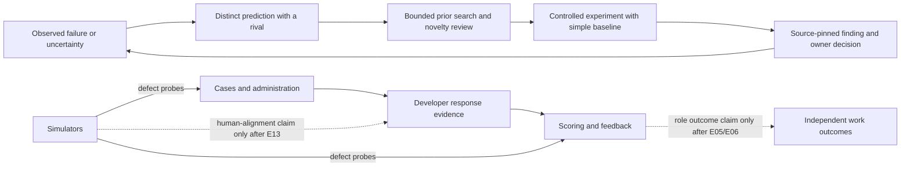

# Research novelty and human-simulation design readout

Status: **author research/design synthesis, 2026-10-27**. No independent novelty adjudication, participant collection, human calibration, score validity finding or hiring claim follows from this work. The [program method](PROGRAM-NOVELTY-METHOD.md) is now `ea.program-novelty-rules/0.4`, a candidate procedure with a separate research-workflow unit, not an issued Lab standard. The [v8 review cut](program-novelty/review-packets/cut-2026-10-27-v8/README.md) covers all eight units with PN-11 and its corrected coding-prior leads; v6–v7 remain frozen under v0.4 and v1–v5 under v0.3.

## The decision we are building toward

The product wants three short case sessions to reveal useful engineering performance. The immediate research problem is narrower: **can we create, detect and improve the specific response evidence each session needs without mistaking attractive AI output for human behavior or a valid hiring score?** We need several separate tests because a generated case can be unusual yet impossible, a simulator can sound human yet forecast the wrong paths, and a scorer can agree with an author-generated answer while missing a real developer's valid route.

## What is defined now

| Research layer | Concrete candidate material | What it can establish now |
| --- | --- | --- |
| Novelty rule | Seven [NR-01–07 checks](PROGRAM-NOVELTY-METHOD.md): bounded prior, operative difference, divergent prediction, source chain, executable contrast, usefulness/harms, execution/replication, applied to eight research units under v0.4; [author adversarial audit](PROGRAM-NOVELTY-ADVERSARIAL-AUDIT.md) | A versioned way to **review** ideas, not an automatic global originality score. |
| Hypothesis search | [Nine proposal operators](PROGRAM-HYPOTHESIS-SEARCH-OPERATORS.md), a [failure-ledger procedure](PROGRAM-HYPOTHESIS-GENERATOR.md), [24 unregistered slate hypotheses](PROGRAM-NOVELTY-HYPOTHESES.md) and a separate [post-v6 view-diversity candidate H-N05](PROGRAM-HYPOTHESIS-DIVERSITY-CANDIDATE.md) | A reproducible source for candidate tests, with the causal rival and defeat condition retained; H-N05 is not in the frozen packets. |
| Example records | [Eleven seeds and eleven packets](program-novelty/packets.json) spanning **all eight** v0.4 units: hypothesis, simulator, case, scorer, evaluator, workflow, study and feedback; [26 proposed fixtures](PROGRAM-NOVELTY-FIXTURES.md) include study-design contrasts | Source-pinned authoring examples only. PN-11 tests whether E12 extraction adds unstated logic or leaks arms. The [v8 masked packet](program-novelty/review-packets/cut-2026-10-27-v8/README.md) has blank ratings; coverage is not validation. |
| Prior work | [Targeted literature ledger](PROGRAM-NOVELTY-SOURCE-LEDGER.md) and [candidate-specific search cut](PROGRAM-NOVELTY-PRIOR-CUT-2026-10-27.md) | Closest leads in a dated, incomplete corpus; no worldwide priority conclusion. |
| Method evaluation | [E12 four-arm design](PROGRAM-NOVELTY-EXPERIMENT.md), [15-cell v2 feasibility allocation](program-novelty/e12-feasibility/assignments-v2.json) and [packet](PROGRAM-E12-FEASIBILITY-PACK.md), [program measurement specification](PROGRAM-NOVELTY-MEASUREMENT.md) and [reviewer-calibration design](PROGRAM-NOVELTY-REVIEWER-CALIBRATION.md) | Designs to test whether the rules produce **distinct executed decisions per total cost** and whether retrieval, judgment and rationale agree with experts. None has run; v1 allocation was superseded before execution. |
| Human simulation | [B0–B3/M1–M4 model family](simulation/HUMAN-ALIGNMENT-MODEL.md), separate [M5 resource-bounded rival](simulation/RESOURCE-BOUNDED-SIMULATOR.md), [E13 human-bridge design](simulation/HUMAN-ALIGNMENT-EXPERIMENT.md), [precision plan](simulation/E13-PRECISION-PLAN.md), [persona-effect protocol](simulation/PERSONA-ANSWER-EFFECT-MEASUREMENT.md) | Testable predictions for paths, reveals and case-fact interventions; no estimate of developer behavior yet. |
| Scoring | [SM-01–03 proposals](SCORING-MODEL-CANDIDATES.md) and [case-versus-rater sensitivity check](SCORING-DESIGN-SENSITIVITY.md) | Explicit rivals for a graph scorer, conditional reveal rating and selective review; illustrative variance arithmetic only. |

The first source-pinned synthetic canary found **0/4 coded first-move uptake per tested thinking-pattern level** on one S1 case, with non-isolated coding. The larger **3,424-row assignment plan has zero solver runs**. Neither gives a population effect of persona changes on developers. The E02 synthetic generation cut did expose a copied authoring instruction and a guided-question burden signal; neither is a human case-quality estimate. These are useful failure seeds, not human findings.

## What would count as a better simulator?

The first practical target is **more confirmed case/scorer defects per model plus reviewer cost** on unseen cases, without false alarms. That does not require human resemblance. A stronger human-alignment claim requires a model to forecast held-out developers' coded first operation, valid path family and reveal transition better than simple empirical frequency, neutral LLM, calibrated persona and context samplers. A separate randomized case-fact contrast tests whether the model reacts in the correct direction and magnitude; matching only the average path mix is insufficient. A later task-history or concept-state model must beat simple persistence/familiarity baselines on the same eligible, consented people and account for privacy cost. Even then, score validity is a separate E03/E05/E06 chain.

The [draft response-path codebook](simulation/RESPONSE-PATH-CODEBOOK.md) names the observable labels, opportunity and transcript-unknown states, and blind Turn 1/Turn 2 coding order for E13. It has no human labels or reliability result; it is a protocol input, not a human-performance finding.

The [E10 downstream-utility extension](simulation/SIMULATOR-DOWNSTREAM-UTILITY.md) makes this operational: compare defect yield, human path forecasts and scorer gains as three outcomes. At matched human labels, generated-answer calls and review time, test no synthetic additions, neutral selection, deliberate path diversity and a genuinely human-calibrated simulator on a separate untouched human scorer cut. Cross synthetic training with a reviewed rubric-repair intervention to identify which mechanism helped. A human-like simulator that does not outperform a cheap diversity sampler on scorer error should not be selected for that purpose.

The [M5 resource-bounded rival](simulation/RESOURCE-BOUNDED-SIMULATOR.md) tests whether an externally logged case-fact exposure schedule adds joint path, omission and revision prediction beyond process states, sampled context and a simple time-limit prompt. It is unrun and does not assume that silence reveals what a developer did or did not notice.

[SimBench](https://proceedings.iclr.cc/paper_files/paper/2026/hash/2fc4d6a6400addda7493b9db258c34e0-Abstract-Conference.html) and [He et al.](https://arxiv.org/abs/2610.26524) motivate testing diverse paths, exact timing and simple history baselines; their effects are from other populations/tasks. [Hullman et al.](https://arxiv.org/abs/2602.15785) distinguish exploratory simulation repair from calibrated use of synthetic data for human inference. For this product, any synthetic augmentation must show useful precision beyond a human-only estimate under explicit assumptions and a new human replication cut.

## How we keep the novelty loop honest

1. **Reference relative:** each claim names its local predecessor, dated external search and exact object version. A no-hit is `unknown`.
2. **Behavioral difference:** remove story nouns, style and biography; ask which mechanism or prediction changes.
3. **Decision consequence:** state an observation that would favor the candidate over a cheap rival and a negative result that would retire it.
4. **Independent check:** separate prior retrieval, novelty class, source-supported explanation and executed usefulness. [RINoBench](https://aclanthology.org/2026.lrec-1.370/) shows that expert-like novelty rationales do not ensure expert-aligned decisions in its benchmark.
5. **Repeated exposure:** a result inspected to improve a model becomes development evidence for its successor. The [holdout rule](RESEARCH-HOLDOUT-GOVERNANCE.md) is currently unissued PR-047; its access enforcement and exposure receipts remain implementation work.
6. **Challenge:** a closer prior, failed replication, mislabeled fixture, leaked source or changed role/use produces a linked successor judgment, preserving the earlier one.

The [semantic proposal](../model/novelty-governance/SEMANTIC-PROPOSAL.md) and [AT-G21](../model/carriers/gaps.json) keep the Lab carrier question explicit. Existing RQ09/E12 and RQ10/E13 are candidate Inquiry/Experiment Design records. The rules, packets and designs have no Lab Finding or product authority.

The [research-selection method](PROGRAM-RESEARCH-SELECTION.md) adds a portfolio decision after novelty review: choose tests by the owner decision they could change, prerequisites, cheapest discriminating contrast, total cost and holdout consumption. It deliberately avoids a numeric value-of-information ranking before pilot estimates and a defensible decision model exist.

**Worked cross-layer example (constructed, not an observed scorer failure):** Suppose a fluent Session 2 answer proposes accepting a transaction after the authorization window has expired. A candidate fact-to-claim graph scorer should expose the unsupported authority edge. The rival explanations are a poorly specified case, a missed transcript phrase, or an existing span-anchored rubric that already catches the error. Freeze the exact case facts and paired wrong/concise-valid answers; ask independent experts to adjudicate both. Compare the graph with the current rubric at the same review budget, including false rejection of valid unusual routes. The graph is a useful *local scorer addition* only if the support-edge operation causes a better decision beyond those simpler controls. Even then, real-answer score validity and work prediction need separate human evidence.

The [first-cut overlap audit](PROGRAM-CANDIDATE-OVERLAP-AUDIT.md) identifies nested packets such as PN-03/PN-09 and shared controls such as PN-04/PN-08. It is author-side only; the masked reviewers must make their own first judgments before seeing that map. A same-day PN-02 search correction produced v4 after [HumanLM](https://proceedings.mlr.press/v306/wu26k.html) surfaced as a closer state-alignment prior. The [sibling novelty-research transfer audit](PRECURSOR-NOVELTY-TRANSFER-AUDIT.md) then found that our hypothesis operators and four-way judgment are local adaptations of earlier work; v5 adds that method/protocol as PN-03/PN-09 priors. The old cuts remain frozen.

[Four local challenge events](program-novelty/challenge-events.json) pin the v3→v4, v4→v5 and v7→v8 source corrections with manifest hashes. The last correction adds closer qualitative-coding priors for PN-11. They preserve `NR-01 unknown` and have no independent verdict; the [receipt checker](../tools/validate_program_novelty_challenges.py) checks provenance only.

## Decision sequence

| First decision | Smallest next evidence | If it fails |
| --- | --- | --- |
| Expand persona simulation? | Repaired prompt×case canary with neutral/no-opening controls and isolated Turn 1 coding | Stop that grid axis; use neutral/context/state defect probes. |
| Trust a novelty reviewer? | Two independent first ratings on exact, neutralized fixtures; measure retrieval, class and rationale separately | Keep it as source retrieval assistance and repair the rubric/corpus. |
| Adopt program hypothesis workflow? | E12 feasibility pilot at matched source/time budget, then balanced execution subset | Remove fields that add effort without executed decision value. |
| Add graph scoring or more case evidence? | E04 crossed case/rater study plus SM-01 controls and independent work outcome | Retain the simpler scorer or narrow the one-case interpretation according to the measured error source. |
| Describe a simulator as closer to developers? | E13 permissioned development, calibration and untouched person/case/time holdout; intervention check | Keep it as an adversarial development tool only. |

The immediate blocking evidence is independent domain adjudication of fixture labels and source closure, a repaired persona manipulation, and a permissioned developer pilot with enough precision to compare simple baselines. A large synthetic population cannot substitute for those observations. The three-session hiring thesis remains a hypothesis until case sampling, scorer reliability, role relevance, independent work prediction and decision utility survive their separate tests.
